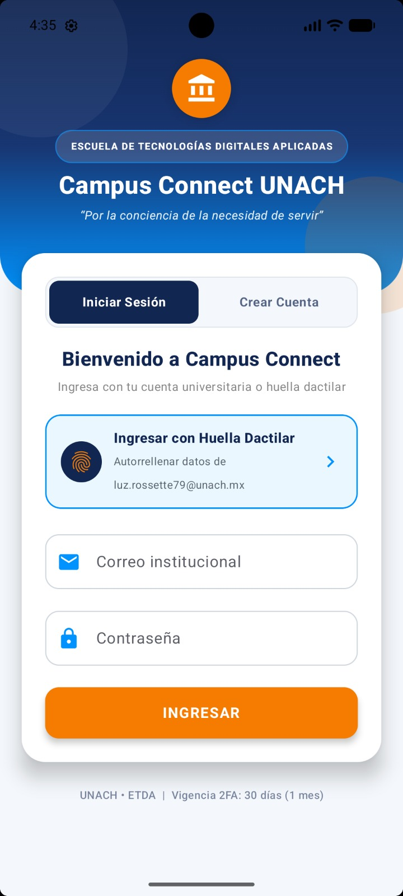
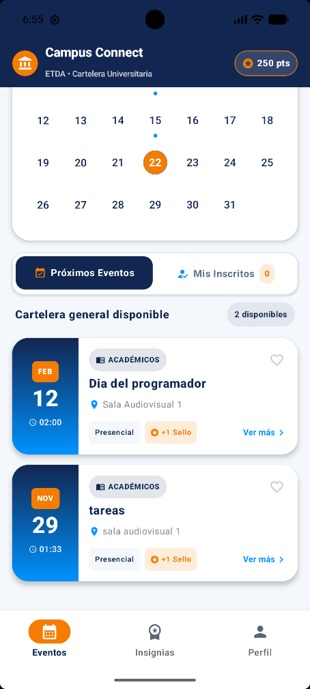
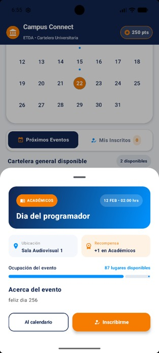
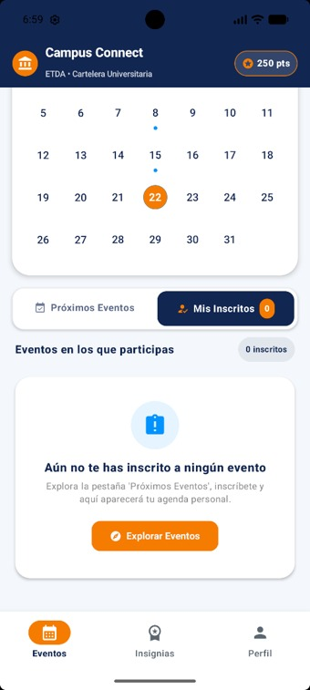
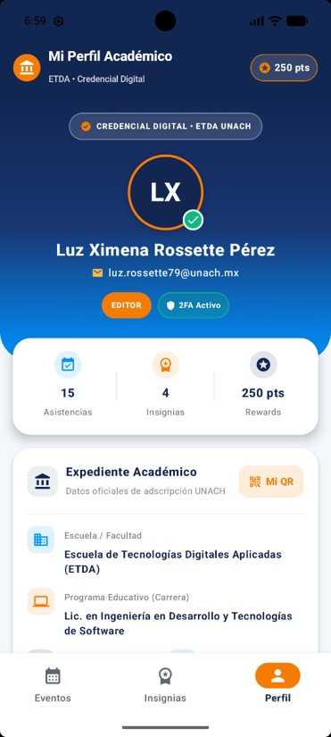
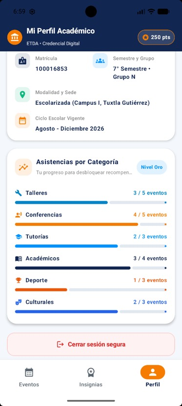
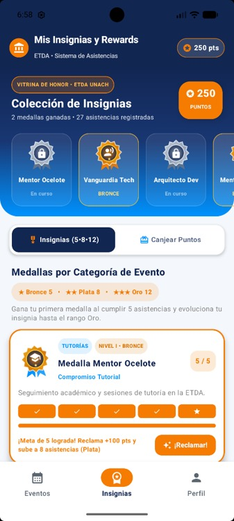
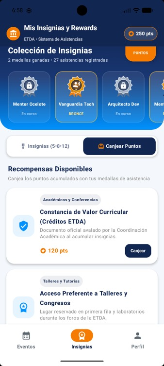

<div align="center">

  

  # 🎓 CampusConnect - UNACH
  **Plataforma integral móvil y web para la comunidad universitaria de la Universidad Autónoma de Chiapas**

  <!-- Insignias de Tecnologías y Estado -->
  []()
  []()
  [](https://android.com)
  [](https://kotlinlang.org/)
  [](https://www.python.org/)
  [](https://developer.mozilla.org/es/docs/Web/JavaScript)
  [](LICENSE)

  <br/>

  <!-- Botón de Descarga Directa del APK -->
  [](URL_DIRECTA_DE_TU_RELEASE_AQUI)

  <p align="center">
    <a href="#-descripción-del-proyecto">Descripción</a> •
    <a href="#-descarga-e-instalación-del-apk">Instalación APK</a> •
    <a href="#-características-principales">Características</a> •
    <a href="#-capturas-de-pantalla">Capturas</a> •
    <a href="#-tecnologías-utilizadas">Tecnologías</a> •
    <a href="#-estructura-del-proyecto">Estructura</a> •
    <a href="#-equipo-de-desarrollo">Equipo</a>
  </p>
</div>

---

## 📖 Descripción del Proyecto

**CampusConnect - UNACH** es una solución integral diseñada para centralizar la comunicación, los servicios académicos y la interacción estudiantil dentro de la **Universidad Autónoma de Chiapas (UNACH)**.

El sistema vincula un ecosistema móvil y web para estudiantes, docentes y personal administrativo, permitiendo consultar avisos en tiempo real, gestionar perfiles académicos, registrar asistencia a eventos mediante biometría y códigos QR, y dar seguimiento a insignias de participación institucional.

---

## 📲 Descarga e Instalación del APK

Puedes instalar directamente la versión compilada para Android en tu teléfono:

1. **Descargar el archivo:** Haz clic en el botón superior **[Descargar APK Android]** o dirígete al apartado de [Releases](../../releases) del repositorio y descarga el binario `app-debug.apk`.
2. **Habilitar fuentes desconocidas:**
   * En tu dispositivo Android, dirígete a **Ajustes > Seguridad y privacidad > Instalar aplicaciones desconocidas**.
   * Concede el permiso al navegador o administrador de archivos que utilices.
3. **Instalación:** Abre el archivo descargado y confirma la instalación en el dispositivo.

---

## ✨ Características Principales

- 🔐 **Autenticación Institucional y 2FA:** Inicio de sesión seguro con correo UNACH, autenticación en dos factores (código OTP) y acceso biométrico por huella dactilar.
- 📅 **Cartelera Universitaria y Eventos:** Exploración de eventos académicos y culturales filtrados por sede, facultad o carrera.
- 🎟️ **Registro y Control de Asistencia:** Inscripción a conferencias y validación presencial ágil.
- 🏆 **Gamificación e Insignias:** Sistema de méritos, puntos acumulados y distinciones por participación estudiantil.
- 👤 **Gestión de Perfil:** Consulta de carrera, grupo adscrito, datos de contacto y configuración de privacidad.

---

## 📱 Capturas de Pantalla

### 🏛️ Acceso y Cartelera de Eventos

<div align="center">
  <table>
    <tr>
      <th align="center">Inicio de Sesión / 2FA</th>
      <th align="center">Cartelera de Eventos</th>
      <th align="center">Detalle del Evento</th>
      <th align="center">Control de Inscritos</th>
    </tr>
    <tr>
      <td align="center">
        
      </td>
      <td align="center">
        
      </td>
      <td align="center">
        
      </td>
      <td align="center">
        
      </td>
    </tr>
    <tr>
      <td align="center"><i>Acceso institucional y biometría</i></td>
      <td align="center"><i>Eventos y actividades UNACH</i></td>
      <td align="center"><i>Información, sede y cupo</i></td>
      <td align="center"><i>Asistencia confirmada</i></td>
    </tr>
  </table>
</div>

<br />

### 👤 Perfil, Méritos y Reconocimientos

<div align="center">
  <table>
    <tr>
      <th align="center">Perfil Estudiantil</th>
      <th align="center">Detalles de Perfil</th>
      <th align="center">Insignias Académicas</th>
      <th align="center">Puntos y Horas</th>
    </tr>
    <tr>
      <td align="center">
        
      </td>
      <td align="center">
        
      </td>
      <td align="center">
        
      </td>
      <td align="center">
        
      </td>
    </tr>
    <tr>
      <td align="center"><i>Datos académicos generales</i></td>
      <td align="center"><i>Seguridad y facultades</i></td>
      <td align="center"><i>Logros universitarios</i></td>
      <td align="center"><i>Métricas de participación</i></td>
    </tr>
  </table>
</div>

---

## 🛠️ Tecnologías Utilizadas

- **Aplicación Móvil:** Android Nativo, Kotlin, Jetpack Compose, Material Design 3, Coroutines & StateFlow.
- **Servicios Backend:** Python, FastAPI, Autenticación JWT, Verificación 2FA, PostgreSQL.
- **Plataforma Web:** JavaScript modular, HTML5 semántico, CSS3 institucional.
- **Herramientas de Construcción y CI/CD:** Gradle (Kotlin DSL), Git, GitHub Releases.

---

## 📂 Estructura del Proyecto

```text
CampusConnect-UNACH/
├── app/                         # Aplicación móvil en Android Studio (Kotlin)
├── campus-connect-backend/      # API REST en Python / FastAPI y modelos DB
├── campus-connect-web/          # Dashboard administrativo en HTML/JS
├── assets/
│   ├── images/
│   │   └── iconapp.png          # Ícono principal de la aplicación
│   └── screenshots/             # Capturas de pantalla en formato JPEG
│       ├── login.jpeg
│       ├── eventos.jpeg
│       ├── detalleseventos.jpeg
│       ├── inscritos.jpeg
│       ├── perfil.jpeg
│       ├── detallesperfil.jpeg
│       ├── insignias.jpeg
│       └── puntos.jpeg
├── build.gradle.kts             # Configuración raíz del build
└── README.md                    # Documentación principal
